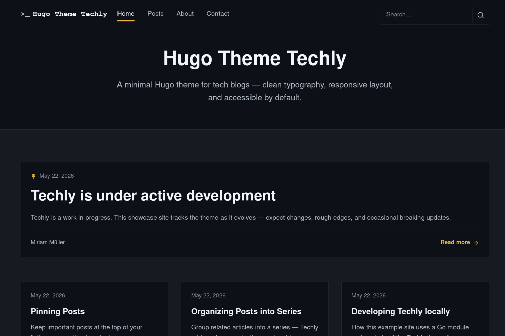

# Techly

A clean, accessible Hugo theme for tech blogs — readable typography, responsive layout, and sensible defaults for developer-focused writing.



**[Demo](https://m1rm.github.io/hugo-techly/)** · **[Source](https://github.com/m1rm/techly)**

## Features

- Responsive layout with a featured post on the home page and a grid for the rest
- Paginated home page, tag archives, and series listings
- Automatic light/dark mode via `prefers-color-scheme`
- Client-side search with live suggestions (JSON index)
- Table of contents on posts and optional TOC on pages
- Post series with in-article notice, navigation, and archive pages
- Pin important posts to the top of section listings
- Related posts with optional “More in …” tag links
- Footer social links via `menus.social` and SVG icons
- Breadcrumbs, tags, and optional cover images
- Notice boxes (info, tip, warning, caution) via the `notice` shortcode
- SEO basics: opt-in indexing, canonical links, sitemap, and a 404 page
- Optional home-page call-to-action block (`params.newsletter`)
- Optional site overrides in `assets/css/custom.css`
- Accessible markup: skip links, landmarks, focus styles, semantic headings

## Requirements

- Hugo **0.146.0** or later (Extended recommended)
- Go (for Hugo Modules)

## Installation

Techly **v2** is distributed as a Hugo Module. From your site root:

```bash
hugo mod init github.com/your-user/your-site
hugo mod get github.com/m1rm/techly/v2@v2.0.1
```

Add the theme to your site's `hugo.toml`:

```toml
[module]
  [[module.imports]]
    path = "github.com/m1rm/techly/v2"
    version = "v2.0.1"
```

Then fetch modules and start the development server:

```bash
hugo mod get
hugo server
```

> **Note:** Use **v2.0.1** or later for module installs. The v2.0.0 tag shipped with an incorrect `go.mod` module path; v2.0.1 fixes that.

See the [demo site repository](https://github.com/m1rm/hugo-techly) for a full working example.

### Upgrading from v1.x

1. Change the module path to `github.com/m1rm/techly/v2` and pin `version = "v2.0.1"` (or newer).
2. Run `hugo mod get github.com/m1rm/techly/v2@v2.0.1`.
3. Move your home-page subtitle into `[params.banner]` (see below) — the navbar still uses `title`, while the home hero uses `params.banner`.

## Site configuration

Hugo does not merge every setting from theme modules into your site. Add the following to your site's `hugo.toml` so search, series and syntax highlighting work correctly:

```toml
[taxonomies]
  tag = "tags"
  series = "series"

[outputs]
  home = ["HTML", "RSS", "JSON"]

[markup.highlight]
  noClasses = false
```

`noClasses = false` makes Hugo mark up code blocks with CSS classes, which Techly styles for light and dark mode. Without it, Hugo uses inline Monokai colors, and plain text in code blocks can be unreadable.

If your site already defines `[taxonomies]`, include every taxonomy you still need — Hugo replaces the list rather than merging entries from the theme.

### Theme parameters

| Parameter | Default | Description |
| --- | --- | --- |
| `params.mainSections` | `["posts"]` | Sections used for the home page and post listings |
| `params.banner.heading` | — | Home page hero title (navbar uses `title`) |
| `params.banner.subheading` | — | Home page hero subtitle; falls back to `params.description` |
| `params.description` | — | Site description (meta, footer fallback) |
| `params.showPostImages` | `true` | Show cover images on listing cards |
| `params.author.name` | — | Default post author name |
| `params.author.avatar` | — | Default author avatar URL |
| `params.footer.tagline` | — | Footer tagline |
| `params.footer.copyright` | — | Footer copyright name |
| `params.footer.since` | — | Start year; range `since - current` only when `since` differs from the current year |
| `params.footer.showSocial` | `true` | Show `menus.social` in the footer |
| `params.related.enabled` | `true` | Show related posts on single pages |
| `params.related.limit` | `3` | Maximum related posts |
| `params.related.heading` | `"More articles"` | Related section heading |
| `params.related.moreLink` | `"best"` | Tag CTA strategy: `best`, `first`, `all`, or `none` |
| `params.related.moreLabel` | `"More in %s"` | Label for the tag CTA (`%s` = tag name) |
| `params.indexHome` | `true` | Index the home page and include it in `sitemap.xml` |
| `params.newsletter` | — | Optional home-page CTA (see below) |
| `params.searchPagePath` | — | Override search page path (default: `/search` or `/page/search`) |

Example:

```toml
[params]
  description = "Notes on software, systems, and the web."
  mainSections = ["posts"]

  [params.banner]
    heading = "My Blog"
    subheading = "Notes on software, systems, and the web."

  [params.author]
    name = "Your Name"

  [params.footer]
    since = 2020
    tagline = "Built with Hugo and Techly."
    copyright = "Your Name"

  [params.related]
    limit = 3
    moreLink = "best"
```

### Menus

Define navigation in `hugo.toml`:

```toml
[[menus.main]]
  name = "Home"
  pageRef = "/"
  weight = 10

[[menus.main]]
  name = "Posts"
  pageRef = "/posts/"
  weight = 20
```

### Footer social links

Add a `social` menu and place SVG icons in your site's `assets/icons/` (for example `assets/icons/github.svg`). Each entry references the icon base name:

```toml
[[menus.social]]
  name = "GitHub"
  url = "https://github.com/your-user"
  weight = 10
  [menus.social.params]
    icon = "github"
```

Set `params.footer.showSocial = false` to hide the block.

### Newsletter call-to-action

The CTA appears on the **home page only** when configured:

```toml
[params.newsletter]
  title = "Stay up to date"
  text = "Get notified when new posts are published."
  url = "https://example.com/subscribe"
  label = "Subscribe"
  external = true
```

### Custom CSS

Add `assets/css/custom.css` in your site. Techly includes it after the theme stylesheets (processed and fingerprinted in production builds).

## Content

### Posts

Create a new post:

```bash
hugo new posts/my-post.md
```

Useful front matter fields:

```toml
title = "My Post"
description = "A short summary for cards and meta tags."
tags = ["hugo", "go"]
series = ["My Series"]
featuredImage = "cover.jpg"
toc = true

[params]
  pinned = true
  pinnedIndicator = true
  author = "Guest Author"
```

### Pinning posts

Pinned posts sort to the top of **section listing pages** (for example `/posts/`). Among pinned posts, newest still comes first.

```toml
[params]
  pinned = true
```

To show a pin icon on listing cards:

```toml
[params]
  pinned = true
  pinnedIndicator = true
```

### Post series

1. Enable the `series` taxonomy in your site's `hugo.toml` (see above).
2. Tag posts with a series name:

```toml
series = ["Building in Public"]
```

Techly adds a notice at the top of each post, a navigation box after the article, and archive pages at `/series/` and `/series/<slug>/`.

Optional series descriptions:

```bash
hugo new series/building-in-public/_index.md
```

### Table of contents

Posts show a table of contents by default. Hide it on a single post with:

```toml
toc = false
```

Pages don't show one unless you enable it:

```toml
toc = true
```

The table of contents only appears when the content has headings within `markup.tableOfContents` `startLevel`–`endLevel` (Hugo's default: `##` and `###`), so posts without such headings get no empty box.

### Notices

Highlight a passage with the `notice` shortcode. The content is Markdown.

```markdown

Techly is developed on [GitHub](https://github.com/m1rm/techly).

```

Techly ships four types:

| Type | Color | Use for |
| --- | --- | --- |
| `info` (default) | blue | background information |
| `tip` | green | helpful advice |
| `warning` | amber | something to watch out for |
| `caution` | red | risk of breaking something or losing data |

`note` is accepted as an alias for `info`, so content written for [hugo-notice](https://github.com/martignoni/hugo-notice) keeps working. Remove `hugo-notice` from your module imports, or its `notice` shortcode takes precedence.

Set a custom title as the second argument, or use named parameters:

```markdown
…
…
```

Notices render as an `<aside role="note">` with the theme's blockquote look: a colored left border, an icon and a bold title, with upright body text. The default colors meet WCAG AA contrast in light and dark mode. An unknown type stops the build with an error that lists the configured types.

#### Configuring notices

Each type is configured under `params.notices.<type>` with three keys:

| Key | Description |
| --- | --- |
| `title` | Default title |
| `icon` | Name of an SVG in `assets/icons/` (without `.svg`), or `""` for no icon |
| `color` | Border, title and icon color: one value for both modes, or `{ light = "…", dark = "…" }` |

The theme's defaults are merged with your config, so you only set what you change. For example, in `hugo.toml`:

```toml
# One color in light and dark mode
[params.notices.info]
  color = "#005f73"

# Only change the dark mode color, keep the light one
[params.notices.warning.color]
  dark = "#e3b341"

# Your own icon from assets/icons/rocket.svg
[params.notices.tip]
  icon = "rocket"

# No icon
[params.notices.caution]
  icon = ""

# A new type: …
[params.notices.success]
  title = "Done"
  icon = "notice-tip"
  color = { light = "#116329", dark = "#56d364" }
```

The same in `hugo.yaml`:

```yaml
params:
  notices:
    info:
      color: "#005f73"
    warning:
      color:
        dark: "#e3b341"
    success:
      title: Done
      icon: notice-tip
      color:
        light: "#116329"
        dark: "#56d364"
```

Icons are inlined into the page and should use `stroke="currentColor"` or `fill="currentColor"` so they take the notice color. The built-in icons are `notice-info`, `notice-tip`, `notice-warning` and `notice-caution`. When you pick your own colors, check their contrast against the notice background (`#f6f8fa` light, `#161b22` dark); aim for at least 4.5:1.

To translate the titles of a multilingual site, use the i18n keys `notice_<type>` (hyphens become underscores). They take precedence over `title`. For example, in `i18n/de.toml`:

```toml
notice_info = "Info"
notice_tip = "Tipp"
notice_warning = "Warnung"
notice_caution = "Vorsicht"
```

Each notice also has a `notice--<type>` class for further styling in [`assets/css/custom.css`](#custom-css).

### SEO

Techly uses an opt-in model for search engine indexing. By default, pages are **not** indexed and are **excluded** from `sitemap.xml`. Set `index = true` in front matter on content you want search engines to discover and index.

```toml
index = true
```

This controls two things:

- **`<meta name="robots">`** — pages with `index = true` get `content="index"`; all others get `content="noindex"`.
- **`sitemap.xml`** — only pages with `index = true` are listed.

Auto-generated pages (tag archives, series listings, search, and similar) stay excluded unless you explicitly set `index = true` on them.

The home page is indexed by default. Disable that in your site's `hugo.toml`:

```toml
[params]
  indexHome = false
```

For fine-grained control, set a custom `robots` value instead. When present, it overrides the `index` setting:

```toml
robots = "noindex, follow"
```

Every page also gets a `<link rel="canonical">` pointing to its own permalink. Paginated lists (home, tags, series) point to the current page, e.g. `/page/2/` is canonical to itself. Make sure `baseURL` is the host you want indexed (e.g. without `www`) and redirect other hosts to it on your web server.

If your own layout overrides a paginating template, override the `canonical` block too and call `.Paginate` with the same collection, e.g. `{{ define "canonical" }}{{ partial "head/canonical.html" ((.Paginate .Pages).URL | absURL) }}{{ end }}`. The head renders before `main`, so the head itself cannot know which collection you paginate.

The theme ships a `404.html` (`noindex`, no canonical, not in the sitemap). Point your web server at it, e.g. nginx `error_page 404 /404.html;`.

Point crawlers at your sitemap in `static/robots.txt`:

```
User-agent: *
Allow: /

Sitemap: https://example.com/sitemap.xml
```

### Search

Search uses the JSON home output. Create a content page at `content/search.md`:

```bash
hugo new search.md
```

Set `layout = "search"` in front matter if needed, or use the `_default/search.html` layout provided by the theme. The navbar includes an inline search field with suggestions.

## Project structure

```
.
├── archetypes/          # Default front matter for new content
├── assets/              # CSS, JavaScript, icons
├── images/              # Theme screenshot and thumbnail (for themes.gohugo.io)
├── layouts/             # Templates and partials
├── hugo.toml            # Default theme configuration
└── theme.toml           # Theme metadata
```

## Development

To work on the theme locally with the [demo site](https://github.com/m1rm/hugo-techly):

```go
// hugo-techly/go.mod
replace github.com/m1rm/techly/v2 => ../techly

require github.com/m1rm/techly/v2 v2.0.1
```

```toml
# hugo-techly/hugo.toml
[module]
  [[module.imports]]
    path = "github.com/m1rm/techly/v2"
    version = "v2.0.1"
```

Remove the `replace` directive before publishing or in CI.

## License

Techly is licensed under the [GNU General Public License v3.0](https://github.com/m1rm/techly/blob/main/LICENSE).

## Author

**Miriam Müller** — [miriam-mueller.com](https://miriam-mueller.com)
